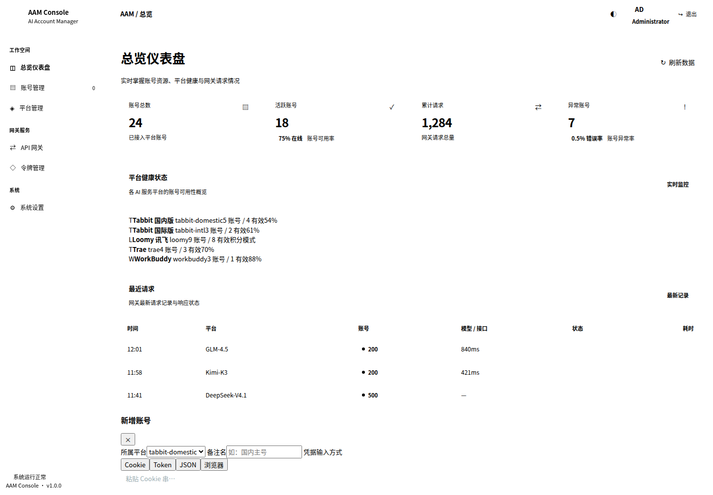
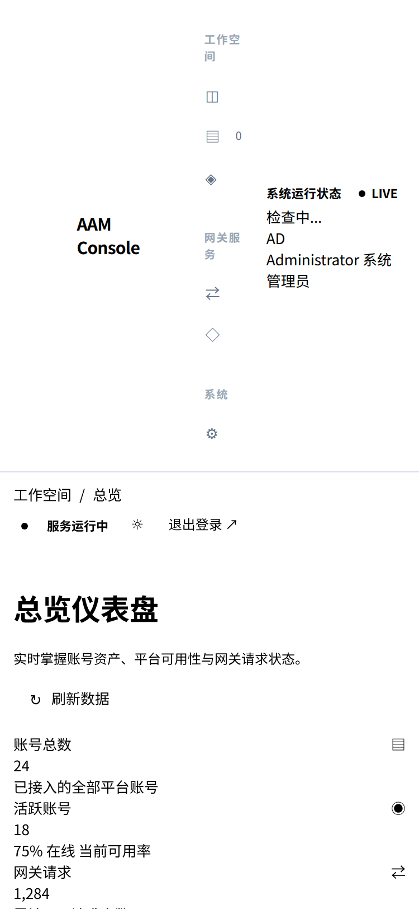
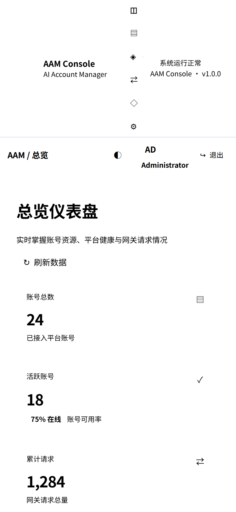

# AAM · AI 账号聚合面板（AI Account Manager）

FastAPI + Vue 3 的 AI 账号聚合与运维面板：把多个 AI 平台账号（Tabbit 国内 / 国际、Trae、WorkBuddy、Loomy 等）聚合成统一账号池，集中管理积分、状态与可用性，并对外暴露 **OpenAI 兼容网关**（`/v1/chat/completions`），用一套 API Key 调用所有平台模型。

## 功能

- **账号管理**：多平台账号增删改查、Cookie / Session / Token 多凭据类型、平台筛选与状态标记
- **积分与状态**：定期检测账号有效性、积分余额、到期时间；配额进度可视化
- **统一网关**：OpenAI 兼容 `/v1/models`、`/v1/chat/completions`（支持流式），按模型路由到对应平台适配器
- **API 密钥**：面板内生成/管理网关密钥
- **每日任务**：Trae 每日签到等任务一键执行（需要 Trae2api 环境）
- **手机验证码登录**：短信添加账号（可选，需要短信平台配置）
- **移动端适配**：桌面 / 手机浏览器均可使用

## 界面预览

| 深色运维控制台 | 浅色企业后台 | 青色运营控制台 |
|---|---|---|
|  |  |  |

移动端：

| 深色 | 浅色 | 青色 |
|---|---|---|
|  |  |  |

> 以上为演示数据（mock）界面截图。

## 目录结构

```
.
├── backend/            # FastAPI 后端
│   ├── main.py         # 入口（路由 + 静态前端挂载）
│   ├── api.py          # 面板管理 API
│   ├── gateway.py      # OpenAI 兼容网关
│   ├── db.py           # SQLite（WAL）
│   ├── auth.py         # 管理鉴权（面板密钥 / 签名 Cookie）
│   ├── config.py       # 配置（环境变量）
│   ├── platforms/      # 各平台适配器
│   └── static/         # 前端构建产物（已预构建，开箱即用）
├── frontend/           # Vue 3 + Vite 源码
├── tools/              # 辅助脚本（UI 自检 / Loomy 登录）
├── ARCHITECTURE.md     # 架构说明
├── requirements.txt
├── install.sh          # 一键安装
└── start.sh            # 启动
```

## 快速开始

要求：Python 3.10+（建议 3.11+），Linux / macOS。

```bash
bash install.sh     # 建 venv、装依赖、初始化 data/、生成 .env
bash start.sh       # 启动，默认 0.0.0.0:8710
```

打开 `http://<服务器IP>:8710/`，输入面板密钥登录。

**面板密钥**在首次启动时自动生成，保存在：

```bash
cat data/admin_key.txt
```

## 添加账号（各平台凭据方式）

面板 → **账号池** → **＋新增账号** → 选择所属平台 → 凭据输入方式会**按平台自动限定** → 粘贴凭据 → **保存并自动检测**（保存后会立即调上游检测账号有效性）。

| 平台 | 凭据方式 | 说明 |
|---|---|---|
| Tabbit 国内版 `tabbit-domestic` | Cookie（或手机验证码） | 上游 `web.tabbit.com`；短信加号走面板「手机验证码添加账号」 |
| Tabbit 国际版 `tabbit-intl` | **仅 Cookie** | 上游 `web.tabbit.ai`，面板短信通道只支持国内版域名；该平台需配置可用的 socks5 代理后访问 |
| Trae `trae` | 浏览器登录引导 / Cookie | 走本地 Trae 中转（`openai_compat`），也可用「Trae 账号授权」助手登录 |
| WorkBuddy `workbuddy` | 浏览器授权引导 / JSON | OAuth 授权后凭据自动入库 |
| Loomy `loomy` | Token / JSON | 讯飞 Loomy 会话 Token |

**Cookie 怎么取**：

1. 浏览器登录对应平台（国际版需代理环境）
2. F12 → Network → 任选一个 XHR 请求 → Request Headers → 复制 **Cookie 整行**（形如 `a=1; b=2; session=...`）
3. 面板新增账号粘贴，保持 Cookie 方式提交

> Cookie 会过期，失效后在账号行点「编辑」粘贴新 Cookie 即可。凭据保存在本地 SQLite（`data/`），不会上传。

## 环境变量（.env）

| 变量 | 说明 |
|---|---|
| `AAM_SIGN_KEY` | 会话签名密钥（32+ 位十六进制随机值，**务必修改**） |
| `TRAE2API_DATA` / `TRAE2API_ENV` | 可选：Trae2api 的 accounts.json / .env 路径（每日签到用） |
| `LOOMY_AK_ID` / `LOOMY_AK_SECRET` / `LOOMY_APPID` | 可选：Loomy 密码登录签名凭据 |
| `CHROME_BIN` | 可选：`tools/ui_check.py` 使用的浏览器路径 |

## 网关调用

在面板「API 密钥」页创建密钥后：

```bash
curl http://127.0.0.1:8710/v1/chat/completions \
  -H "Authorization: Bearer <你的密钥>" \
  -H 'Content-Type: application/json' \
  -d '{"model":"tabbit-domestic/GLM-5.1","messages":[{"role":"user","content":"你好"}]}'
```

模型列表：`GET /v1/models`。

## 前端开发

已预构建的静态文件在 `backend/static/`，直接启动即可。修改前端源码后：

```bash
cd frontend
npm install
npm run build     # 产物输出到 backend/static（vite base='./'）
cd .. && systemctl restart aam-panel   # 或 bash start.sh
```

## 安全注意事项

- `data/` 目录包含 SQLite 数据库（账号凭据、会话）与面板密钥，**不要提交到公开仓库**（`.gitignore` 已排除）。
- 部署到公网时建议：修改 `AAM_SIGN_KEY`、首次登录后轮换网关密钥、按需加反向代理与 HTTPS。
- 面板管理接口有登录鉴权（`X-Admin-Key` 头或登录 Cookie），未登录不可访问。

## systemd 部署（可选）

见 `deploy/aam-panel.service` 示例，替换路径与用户后：

```bash
sudo cp deploy/aam-panel.service /etc/systemd/system/
sudo systemctl daemon-reload && sudo systemctl enable --now aam-panel
```

## 免责声明

本项目仅用于个人学习与自用账号管理。请遵守各平台服务条款，不得用于批量注册、转售等违规用途。
