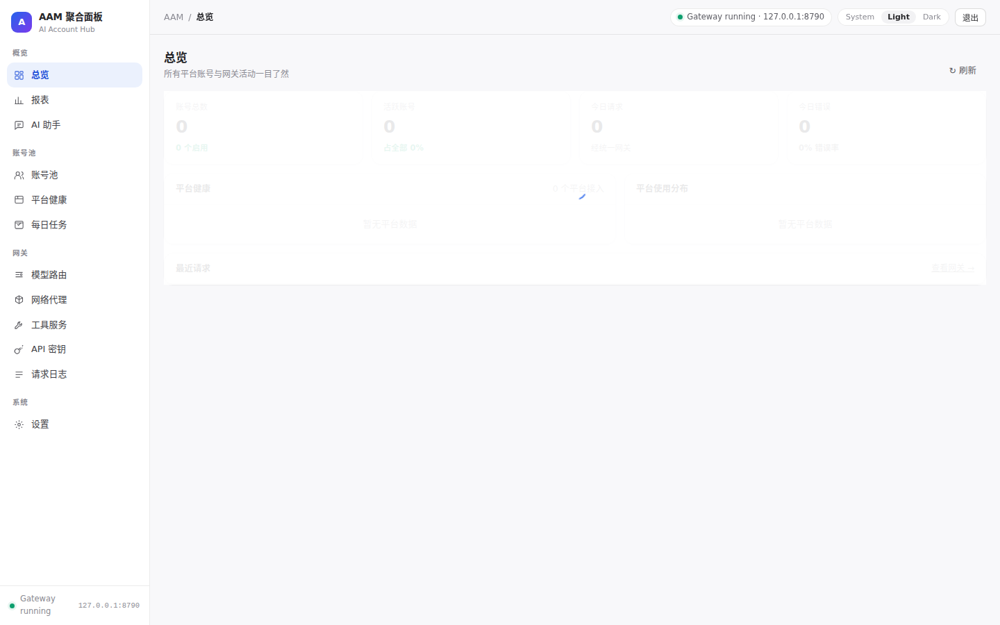
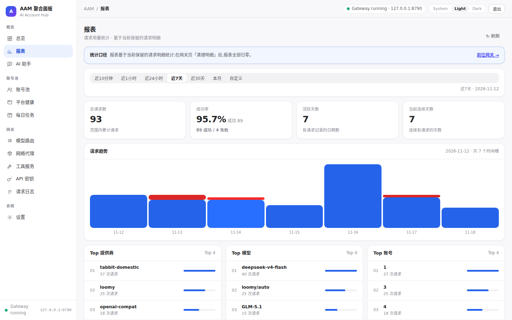
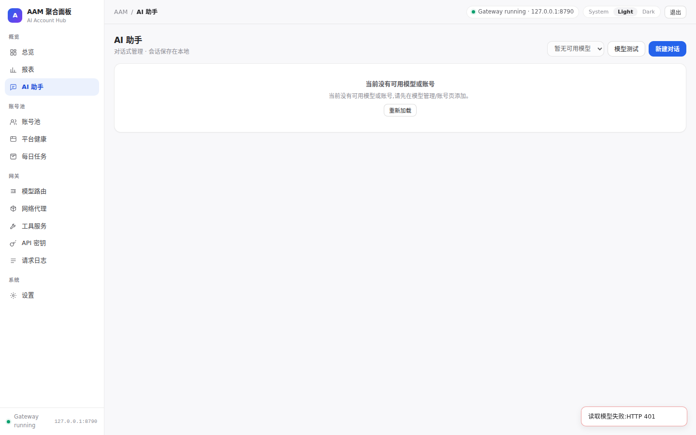
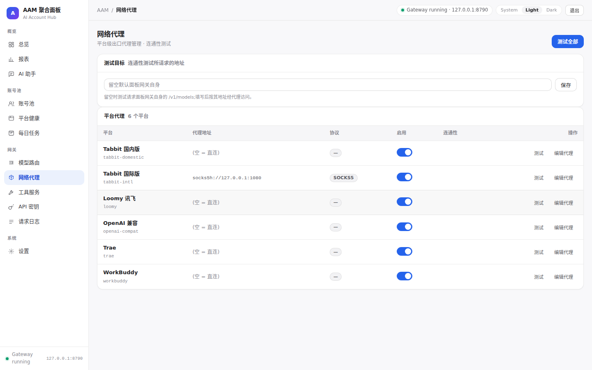
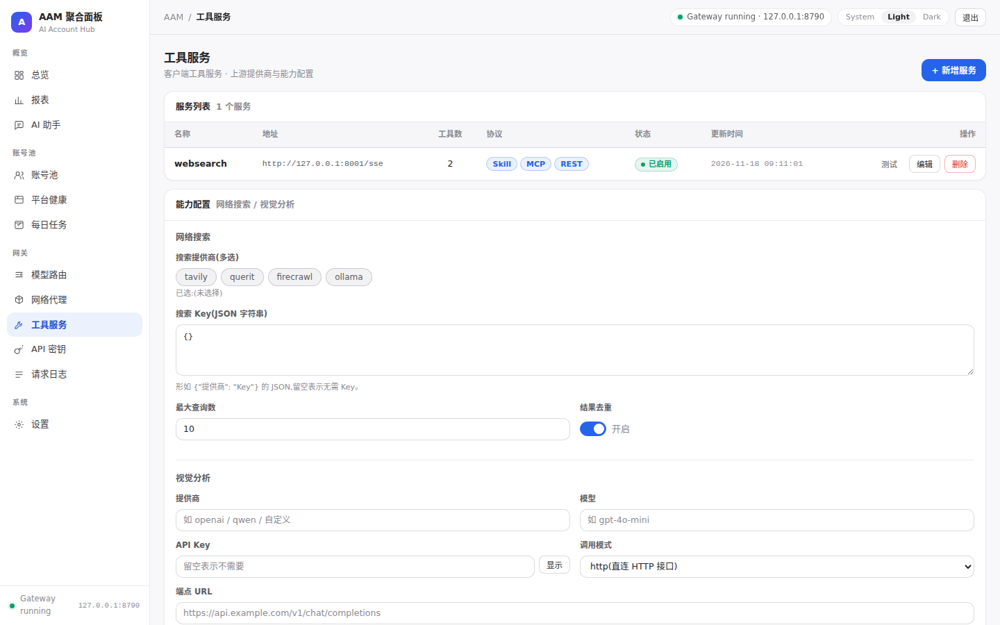

# AAM · AI 账号聚合面板（AI Account Manager）

FastAPI + Vue 3 的 AI 账号聚合与运维面板：把多个 AI 平台账号（Tabbit 国内 / 国际、Trae、WorkBuddy、Loomy 等）聚合成统一账号池，集中管理积分、状态与可用性，并对外暴露 **OpenAI 兼容网关**（`/v1/chat/completions`），用一套 API Key 调用所有平台模型。



## 功能

- **账号管理**：多平台账号增删改查、Cookie / Session / Token 多凭据类型、平台筛选与状态标记
- **积分与状态**：定期检测账号有效性、积分余额、到期时间；配额进度可视化；每日 08:00 自动巡检（可配 Webhook 通知）
- **统一网关**：OpenAI 兼容 `/v1/models`、`/v1/chat/completions`（支持流式），按模型路由到对应平台适配器，账号轮询负载
- **API 密钥**：面板内生成/管理网关密钥，支持「绑定平台」作用域
- **网络代理**：平台级出口代理管理（HTTP / SOCKS5），启停、批量连通性测试、出口 IP 检查
- **工具服务**：MCP / Skill / REST 服务注册与连通性测试；网络搜索（Tavily / Querit / Firecrawl / Ollama）与视觉分析等能力配置
- **报表**：请求用量统计（总量 / 成功率 / 活跃天数 / 连续天数）、按天或小时趋势、Top 提供商·模型·账号排行，支持自定义时间区间
- **AI 助手**：对话式管理（会话保存在本地、后端薄代理持密钥调用网关、独立限流），支持模型下拉与连通性测试
- **每日任务**：Trae 每日签到等任务一键执行（需要 Trae2api 环境）
- **手机验证码登录**：短信添加账号（可选，需要短信平台配置）
- **移动端适配**：桌面 / 手机浏览器均可使用；深色 / 浅色主题切换

## 界面预览

| 报表 | AI 助手 |
|---|---|
|  |  |

| 网络代理 | 工具服务 |
|---|---|
|  |  |

## 快速开始（一键部署）

环境要求：**Python 3.10+**（仅后端；前端已预构建在 `backend/static`，无需 Node.js）。

```bash
git clone https://github.com/lovexme/juhefd.git
cd juhefd
bash install.sh        # 创建 venv、安装依赖、生成 .env
bash start.sh          # 默认 http://0.0.0.0:8710
```

首次启动后：

1. 浏览器打开 `http://<你的服务器IP>:8710`
2. 面板密钥自动生成在 `data/admin_key.txt`（也可在「设置」页修改）
3. 输入密钥登录 → 「账号池」添加账号 → 「平台健康」确认状态 → 「模型路由」查看可用模型

自定义端口：`bash start.sh 9000`

后台常驻（systemd）见 `deploy/aam-panel.service`：

```bash
sudo cp deploy/aam-panel.service /etc/systemd/system/
sudo systemctl daemon-reload
sudo systemctl enable --now aam-panel
```

## 添加账号

| 平台 | 凭据类型 | 获取方式 |
|---|---|---|
| Tabbit 国内 / 国际 | Cookie | 浏览器登录 [web.tabbit.com](https://web.tabbit.com) / [web.tabbit.ai](https://web.tabbit.ai) → F12 → Network → 任一请求的 Cookie 头复制 |
| Loomy 讯飞 | Session | 客户端 `auth-session.json` 中的 `session` 字段，或用「短信登录」页自动获取 |
| Trae | 平台登录态 | 需先部署 [Trae2api](https://github.com/autumnsentiment/Trae2api-cn) 网关并在「平台健康」填其地址；账号在 Trae2api 侧维护 |
| WorkBuddy | OAuth 授权 | 面板「账号池」→ 添加账号 → WorkBuddy → 按提示完成 OAuth 设备授权 |
| 其它 OpenAI 兼容服务 | API Key / Base URL | 「平台健康」→ 添加平台，适配器选 `openai_compat`，填上游 `/v1` 地址与密钥 |

> 国际平台（如 Tabbit 国际版）通常需要出口代理：在「网络代理」页给对应平台填 `socks5h://127.0.0.1:1080` 之类的本地代理地址，或使用你已有的代理服务。

### 手机验证码添加账号（Tabbit 国内版 / Loomy）

「账号池」→ **手机验证码添加**，选平台 → 填手机号 → 发送验证码 → 填收到的验证码 → 验证并添加。成功后自动取会话凭据、拉取用户信息与额度，并做一次健康检测（`active` 即可用）。

要点：

- **限频按平台独立**：同一手机号在每个平台各 60 秒一次；Tabbit 与 Loomy 互不影响，可以连续给两个平台发码
- **全局 IP 反滥用闸**：同一出口 IP 5 秒内只能触发一次发码（不管哪个平台），防止短信轰炸；正常手动操作不会碰到
- **验证码 5 分钟内有效**；同平台重复提交校验限制 10 秒一次
- **切换平台会清空已填内容**，需要为当前平台重新发码（避免 A 平台验证码被拿去 B 平台校验）
- 新号首次验证码登录通常会自动注册，可直接用于网关调用；`Loomy` 新账号一般带每日赠送额度


## 统一网关调用

```bash
# 模型列表
curl http://127.0.0.1:8710/v1/models \
  -H "Authorization: Bearer <你的API密钥>"

# 对话（非流式）
curl http://127.0.0.1:8710/v1/chat/completions \
  -H "Authorization: Bearer <你的API密钥>" \
  -H "Content-Type: application/json" \
  -d '{"model":"tabbit-domestic/GLM-5.1",
       "messages":[{"role":"user","content":"你好"}]}'

# 流式
curl -N http://127.0.0.1:8710/v1/chat/completions \
  -H "Authorization: Bearer <你的API密钥>" \
  -H "Content-Type: application/json" \
  -d '{"model":"tabbit-domestic/GLM-5.1","stream":true,
       "messages":[{"role":"user","content":"你好"}]}'
```

模型 ID 规则：`<平台key>/<上游模型名>`，如 `tabbit-domestic/GLM-5.1`、`loomy/auto`。裸模型名会遍历所有平台自动解析。API 密钥可在「API 密钥」页创建，支持绑定单一平台（跨平台调用返回 403）。

OpenAI SDK 兼容：

```python
from openai import OpenAI
client = OpenAI(base_url="http://127.0.0.1:8710/v1", api_key="<你的API密钥>")
resp = client.chat.completions.create(model="tabbit-domestic/GLM-5.1",
                                      messages=[{"role": "user", "content": "你好"}])
print(resp.choices[0].message.content)
```

## 环境变量

复制 `.env.example` 为 `.env`（`install.sh` 会自动生成）。常用项：

| 变量 | 说明 |
|---|---|
| `AAM_SIGN_KEY` | 会话签名密钥（安装时自动随机生成，务必不要外泄） |
| `AAM_GATEWAY_KEY` | 网关主密钥默认值（建议首次启动后在面板轮换） |
| `TRAE2API_DATA` / `TRAE2API_ENV` | Trae2api 数据文件/环境文件路径（使用 Trae 每日任务时需要） |
| `LOOMY_AK_ID` / `LOOMY_AK_SECRET` / `LOOMY_APPID` | Loomy 密码登录签名凭据（可选） |
| `CHROME_BIN` | UI 自检脚本浏览器路径（可选） |
| `AAM_DISABLE_SCHEDULER=1` | 关闭每日 08:00 自动巡检（调试用） |

## 目录结构

```
├── backend/            # FastAPI 后端
│   ├── api.py          # 管理接口（/api/*）
│   ├── gateway.py      # OpenAI 兼容网关（/v1/*）
│   ├── assistant_api.py# AI 助手（/api/assistant/*）
│   ├── auth.py         # 面板密钥登录
│   ├── db.py           # SQLite 数据层与建表
│   ├── platforms/      # 平台适配器（tabbit / loomy / openai_compat）
│   ├── static/         # 预构建前端产物
│   └── main.py         # 应用入口
├── frontend/           # Vue 3 + Vite 源码（需要改动 UI 时）
├── tools/              # ui_check.py 页面自检、loomy_login.py 工具
├── deploy/             # systemd 服务示例
├── ARCHITECTURE.md     # 架构与数据契约说明
├── install.sh / start.sh
└── requirements.txt
```

修改前端后重新构建（需要 Node.js 18+）：

```bash
cd frontend && npm install && npm run build   # 产物输出到 backend/static
```

## 页面自检

```bash
# 需要 playwright + chromium
CHROME_BIN=/usr/bin/chromium /usr/bin/python3 tools/ui_check.py http://127.0.0.1:8710/ \
  --admin-key "$(head -2 data/admin_key.txt | tail -1)" --strict \
  --routes '#/, #/report, #/assistant, #/accounts, #/platforms, #/gateway, #/proxies, #/services, #/tokens, #/requests, #/settings' \
  --widths 1440,768
```

## 安全说明

- 面板管理接口（`/api/*`）需要面板密钥登录（HttpOnly Cookie）；网关（`/v1/*`）需要 `Authorization: Bearer <密钥>`。
- 账号凭据仅存储在本地 SQLite（`data/aam.db`），不上传、不写日志。
- `.env`、`data/`、`venv/` 已在 `.gitignore` 中排除 **切勿提交**。
- 部署到公网前建议：使用随机强密钥、在前面加 HTTPS 反向代理、限制管理端口来源 IP。

## 常见问题

**Q：启动报 `ModuleNotFoundError: No module named 'websockets'`？**
A：`pip install -r requirements.txt` 重新安装（新版 requirements 已包含）。

**Q：登录页提示密钥错误？**
A：面板密钥在 `data/admin_key.txt`（第二行）；若与数据库不一致，以数据库 `settings.panel_key` 为准。

**Q：模型调用返回 403 `permission_error`？**
A：你的 API 密钥绑定了其它平台；到「API 密钥」页检查「绑定平台」，或换主密钥调用。

**Q：报表数据为空？**
A：报表基于 `request_log` 明细统计；清空请求日志后报表会归零（与日志页同一数据源）。

**Q：Trae 每日任务显示不可用？**
A：需要外部 Trae2api 服务，并在 `.env` 配置 `TRAE2API_DATA` / `TRAE2API_ENV`。

## 免责声明

本项目仅供学习与个人账号管理使用。请遵守各 AI 平台的服务条款，不要用于商业倒卖或违反平台规则的行为。账号安全与合规使用由部署者自行负责。

## License

MIT
